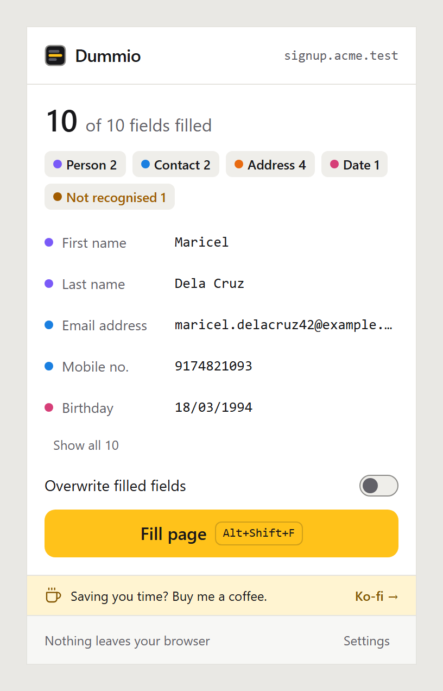
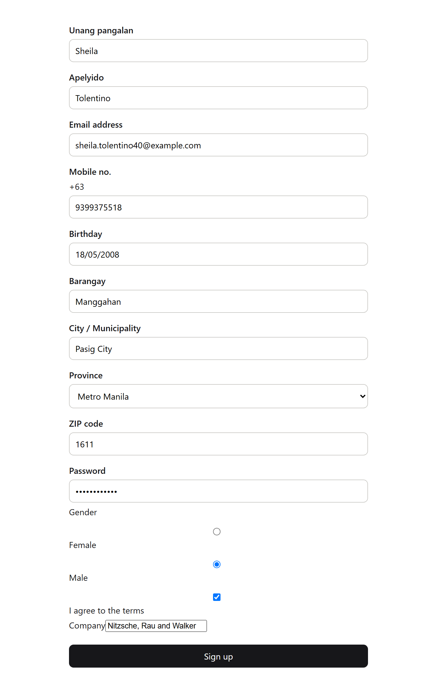
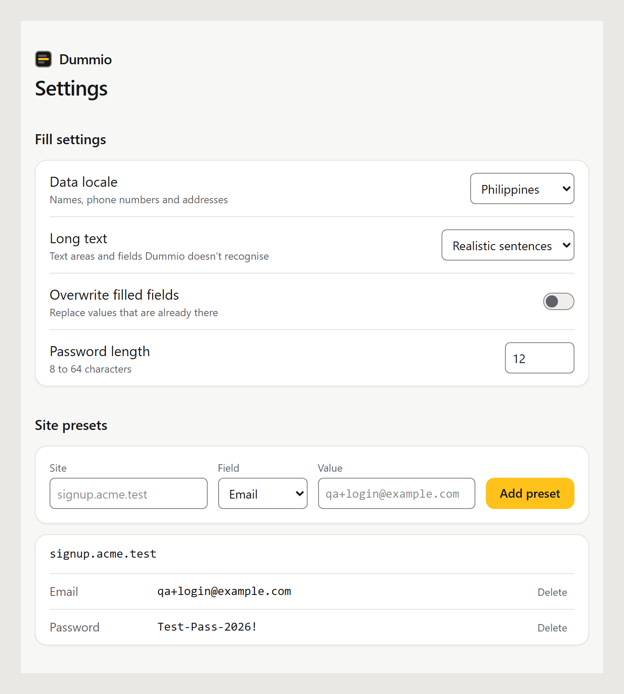

  

  <b>Realistic test data for any form, in one click.</b> 
  The first official release. Free, open source, and it runs entirely in your browser.

  
  
  
  
  

  
  &nbsp;&nbsp;
  

## Download

| Browser              | File                                                                                                      |
| -------------------- | --------------------------------------------------------------------------------------------------------- |
| Chrome, Edge, Brave  | [dummio-chrome.zip](https://github.com/melvinbulan17/dummio/releases/download/v1.0.0/dummio-chrome.zip)   |
| Firefox 140 or newer | [dummio-firefox.zip](https://github.com/melvinbulan17/dummio/releases/download/v1.0.0/dummio-firefox.zip) |

> [!NOTE]
> Dummio isn't in the Chrome Web Store or Firefox Add-ons yet, so for now you install it by hand. The steps are below.

<b>Install in Chrome, Edge or Brave</b>

1. Download **dummio-chrome.zip** and unzip it somewhere you'll keep it, like your Documents folder.
2. Open `chrome://extensions` in the address bar. In Edge it's `edge://extensions`.
3. Switch on **Developer mode**, top right.
4. Click **Load unpacked** and choose the folder you unzipped. Pick the folder that has `manifest.json` inside.
5. Click the puzzle piece in the toolbar and pin **Dummio**.

Chrome may show a banner about developer mode extensions. It does that for anything installed outside the Chrome Web Store.

<b>Install in Firefox</b>

1. Download **dummio-firefox.zip**. You don't need to unzip it.
2. Open `about:debugging#/runtime/this-firefox`.
3. Click **Load Temporary Add-on** and pick the zip.

Firefox removes temporary add-ons when it restarts, so you'll repeat these steps after closing it.

## What it does

- Fills every visible field on a page from the toolbar button or <kbd>Alt</kbd>+<kbd>Shift</kbd>+<kbd>F</kbd>, or one field from the right-click menu.
- Reads what each field expects before writing: date order, phone format, length limits, patterns and split day, month and year dropdowns. If the form still rejects a value, it tries the next likely format.
- Builds one made-up person per fill, so the email matches the name and the street, city, province or state and ZIP belong together.
- Ships with Philippine and US data: about 1,900 Philippine cities and municipalities with real barangays and ZIP codes, and 3,000 US cities.
- Keeps addresses consistent with the form's own province, state and city dropdowns.
- Lets you pin values per site, like your usual test login on staging.

  

## Try it

Open any page with a form. This [public test form](https://www.selenium.dev/selenium/web/web-form.html) works well. Click the Dummio icon, then **Fill page**.

## Privacy

Dummio has no account and no tracking, and it makes no network requests. It only touches a page when you click, press the shortcut or right-click. It asks for four permissions: `activeTab`, `scripting`, `contextMenus` and `storage`. The [privacy policy](https://github.com/melvinbulan17/dummio/blob/v1.0.0/PRIVACY.md) explains each one.

## FAQ

<b>Alt+Shift+F does nothing</b>

Another extension may already use that shortcut, so the browser left it blank. In Chrome, open `chrome://extensions/shortcuts`, find Dummio and set the keys you want. In Firefox, go to `about:addons`, click the gear icon, then **Manage Extension Shortcuts**.

<b>"This page can't be filled"</b>

Browsers keep extensions off their own pages, like settings, new tabs and the extension store. Try it on a regular website.

<b>A field got the wrong kind of value</b>

[Open an issue](https://github.com/melvinbulan17/dummio/issues/new/choose) with the page and the field. A public test page and a screenshot make it much quicker to fix.

<b>A live form might text the number</b>

Philippine mobile numbers use real prefixes, so one could belong to someone. Emails use reserved `example` domains and US numbers use the fictional 555-01XX range, so those never reach a real person.

## Feedback

Found a bug or have an idea? [Open an issue](https://github.com/melvinbulan17/dummio/issues/new/choose). Fixes will ship as 1.0.x updates on the [releases page](https://github.com/melvinbulan17/dummio/releases).

Dummio is free. If it saves you time, you can [buy me a coffee on Ko-fi](https://ko-fi.com/mbulandev).
