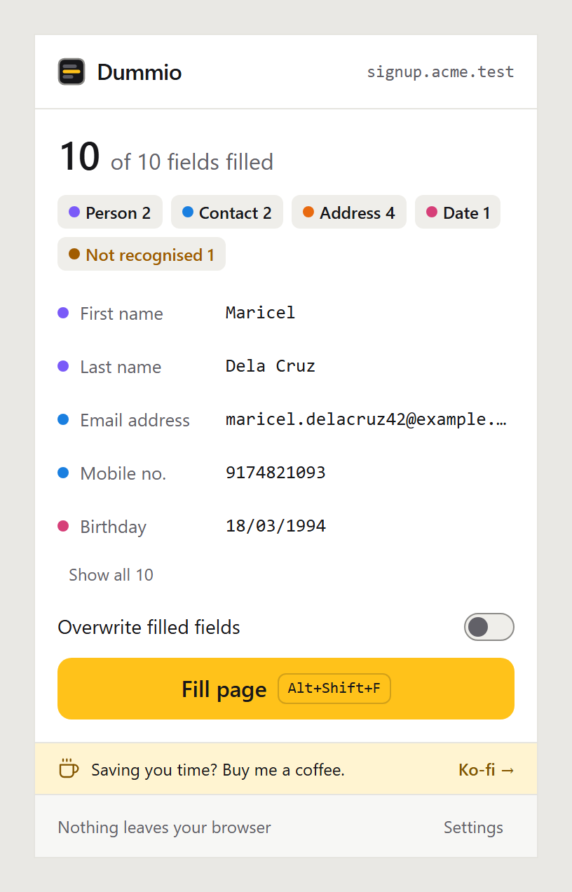
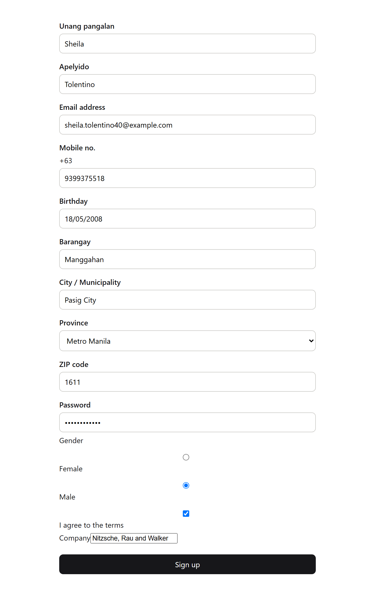
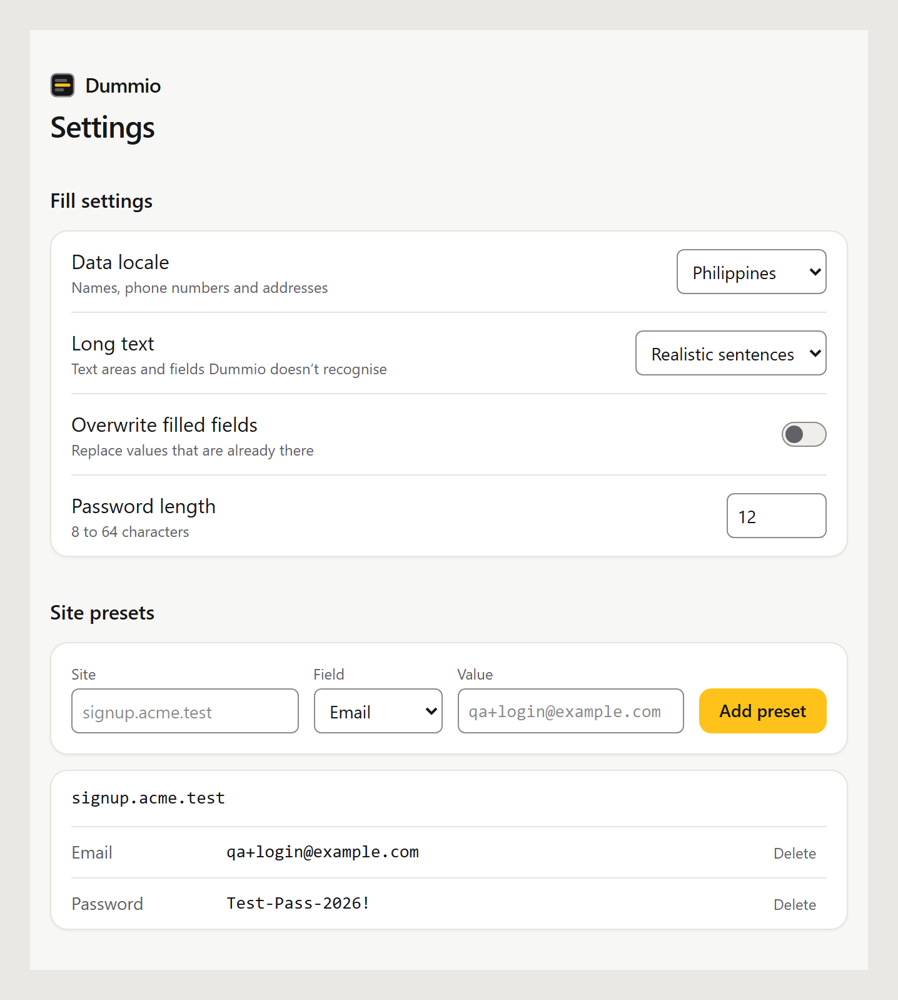
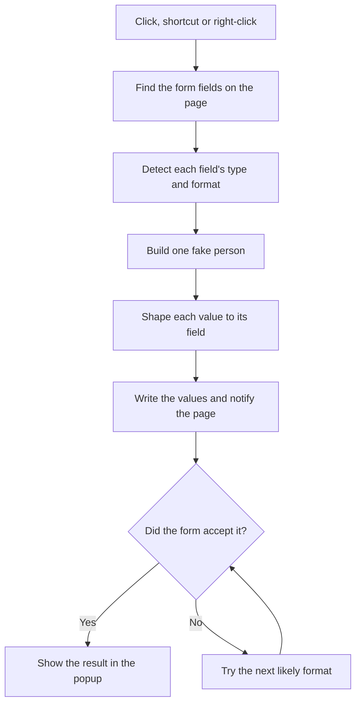

<p align="center">
  
</p>

<h1 align="center">Dummio</h1>

<p align="center">
  <b>Realistic test data for any form, in one click.</b><br>
  A Chrome and Firefox extension that reads each field and fills it with believable data in the shape it expects.
</p>

<p align="center">
  <a href="LICENSE"></a>
  
  
  
</p>

<p align="center">
  <a href="#install">Install</a> ·
  <a href="#what-it-does">What it does</a> ·
  <a href="#how-it-works">How it works</a> ·
  <a href="#privacy">Privacy</a> ·
  <a href="#development">Development</a> ·
  <a href="#credits">Credits</a>
</p>

<p align="center">
  
  &nbsp;&nbsp;
  
</p>

## Install

Dummio isn't in the Chrome Web Store or Firefox Add-ons yet, so for now you install it by hand:

1. Download **dummio-chrome.zip** or **dummio-firefox.zip** from the [latest release](https://github.com/melvinbulan17/dummio/releases/latest).
2. Follow the setup steps on that page. It takes about two minutes.

## What it does

- Fills every visible field on a page from the toolbar button or **Alt+Shift+F**, or one field from the right-click menu.
- Reads what each field expects before writing: date order, phone format, length limits, patterns and split day, month and year dropdowns. If the form still rejects a value, it tries the next likely format.
- Builds one made-up person per fill, so the email matches the name and the street, city, state or province and ZIP belong together.
- Ships with Philippine and US data: about 1,900 Philippine cities and municipalities with real barangays and ZIP codes, and 3,000 US cities.
- Keeps addresses consistent with the form's own province, state and city dropdowns.
- Works with React, Vue and Angular forms.
- Lets you pin values per site, like your usual test login on staging.
- Uses reserved `example.com`, `example.net` and `example.org` emails and fictional 555-01XX US numbers, so test sign-ups with those never reach a real person. Philippine mobile numbers use real prefixes, so don't send live SMS to them.

<p align="center">
  
</p>

## How it works



Each clue on a field, such as its input type, autocomplete hint or label words in English and Filipino, adds points to a field type, and the highest score wins. Values are written the way typing would write them, so frameworks keep them after submit.

## Privacy

Dummio collects nothing and makes no network requests. It only touches a page when you click, press the shortcut or right-click, and asks for four permissions: `activeTab`, `scripting`, `contextMenus` and `storage`. Details are in [PRIVACY.md](PRIVACY.md).

## Development

Requires Node 26 and pnpm.

```bash
pnpm install
pnpm dev
```

`pnpm dev` opens Chrome with Dummio loaded and reloads it on every change. Use `pnpm dev:firefox` for Firefox.

| Script                              | What it does                                 |
| ----------------------------------- | -------------------------------------------- |
| `pnpm dev` / `pnpm dev:firefox`     | Run the extension with hot reload            |
| `pnpm build` / `pnpm build:firefox` | Build into `.output/`                        |
| `pnpm zip` / `pnpm zip:firefox`     | Build a zip for the store                    |
| `pnpm lint`                         | ESLint                                       |
| `pnpm format` / `pnpm format:check` | Prettier                                     |
| `pnpm typecheck`                    | TypeScript                                   |
| `pnpm test`                         | Unit tests in `tests/unit`                   |
| `pnpm test:e2e`                     | Browser tests in `tests/e2e`                 |
| `pnpm data`                         | Rebuild the place and name data from sources |

| Folder          | What's inside                                        |
| --------------- | ---------------------------------------------------- |
| `entrypoints/`  | Background script, content script, popup, settings   |
| `src/detect/`   | Finding fields and working out their type and format |
| `src/generate/` | The fake person, values, formats and data packs      |
| `src/fill/`     | Writing values, dropdowns, checkboxes and radios     |
| `src/storage/`  | Settings and site presets                            |
| `tests/`        | Unit tests, browser tests and sample forms           |

Built with WXT, TypeScript, React, Tailwind CSS v4, Vitest and Playwright.

## Credits

Place and name data, rebuilt with `pnpm data`:

- Philippine ZIP codes and US cities and ZIP codes: [GeoNames](https://www.geonames.org/), licensed under [CC BY 4.0](https://creativecommons.org/licenses/by/4.0/).
- Philippine provinces, cities, municipalities and barangays: the Philippine Standard Geographic Code (PSGC) of the Philippine Statistics Authority, via the [PSGC API](https://psgc.gitlab.io/api/).
- US first names and surnames: U.S. Census Bureau name frequency lists.

Filipino names, mobile prefixes and the sample sentences are maintained by hand in `src/generate/data/`.

Bundled fonts and libraries: [Onest](https://github.com/simpals/onest) and [Fragment Mono](https://github.com/weiweihuanghuang/fragment-mono) under the SIL Open Font License, and [Faker](https://fakerjs.dev/) and React under the MIT License. Full notices are in [public/third-party-notices.txt](public/third-party-notices.txt).

## Support

Dummio is free. If it saves you time, you can [buy me a coffee on Ko-fi](https://ko-fi.com/mbulandev).

## License

[MIT](LICENSE) © 2026 Melvin S. Bulan
